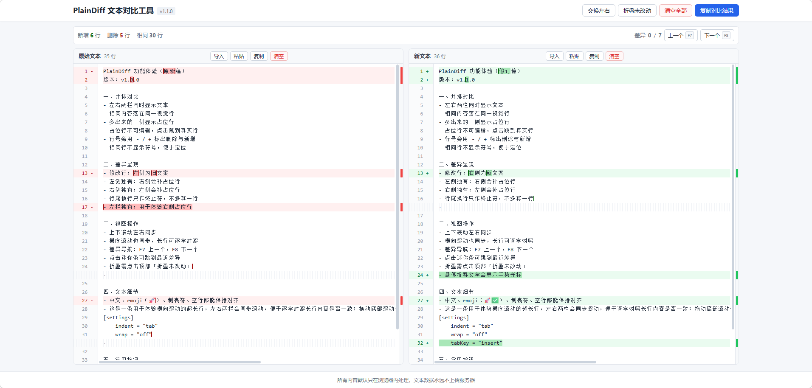

# PlainDiff 文本对比工具 v1.1.0

一个纯前端、可直接双击打开的文本差异对比工具。左右双栏并排、行号对齐、**行内字符级高亮**、滚动同步。
所有文本只在浏览器内存里处理，不会上传任何服务器。

## 界面预览



---

## 一、快速开始

1. 双击 `index.html`（Chrome / Edge 均可）。
2. 在左侧输入/粘贴原始文本，在右侧输入/粘贴新文本。
3. 差异会自动计算并高亮，无需点击"开始对比"。

> 建议把整个目录一起复制，`styles.css`、`app.js`、`vendor/` 都要保留。

## 二、文件结构

```
PlainDiff/
├── index.html                    页面结构（只有 HTML，约 5KB）
├── styles.css                    全部样式（布局、高亮配色、滚动条）
├── app.js                        全部逻辑（diff 计算、渲染、按钮交互）
├── vendor/
│   └── diff-match-patch.js       差异算法库本地副本（CDN 不可用时自动启用）
├── tests/
│   ├── logic.test.js             纯逻辑单元测试（Node 运行，159 项断言）
│   └── static-check.js           HTML/CSS/JS 交叉引用静态检查
└── README.md                     本文件
```

依赖（无需 npm）：

| 资源 | 地址 | 作用 |
|---|---|---|
| diff-match-patch | `https://cdn.jsdelivr.net/npm/diff-match-patch@1.0.5/index.js` | 字符级差异算法（优先从 CDN 加载） |

> `index.js` 末尾有 `module.exports`，浏览器直接引入会报错，因此 `index.html` 在它之前加了
> `window.module = window.module || { exports: {} }` 做兼容。
>
> 断网时 CDN 拿不到库，页面会自动改用 `vendor/diff-match-patch.js`（同版本 1.0.5），
> 所以**离线也能正常对比**。

---

## 三、功能清单

| 功能 | 说明 |
|---|---|
| 左右并排双栏 | 左=原始文本，右=新文本，等宽等高 |
| 按钮分区 | 只作用于某一侧的「导入 / 粘贴 / 复制 / 清空」放在该侧文本框顶部；「交换左右 / 清空全部 / 复制对比结果」等全局按钮保留在顶部工具栏 |
| 直接编辑 | 真正的 `<textarea>`，可正常输入、选中、复制；占位行上的输入会被拦截；按 `Tab` 在文本框内插入制表符，不会把焦点切到按钮 |
| 行号与符号 | 行号右侧紧跟差异符号：左侧删除显示 `-`，右侧新增显示 `+`，相同行留空 |
| 行内字符级高亮 | 左侧删除内容深红底，右侧新增内容深绿底，未变内容白底 |
| 整行底色 | 有差异的整行带很浅的红/绿底色，便于快速定位；红底行数 = 删除数，绿底行数 = 新增数 |
| 相同内容同行 | 两侧相同内容始终落在同一视觉行；多出来的一侧插入浅灰点阵占位行，占位行不可编辑且没有行号 |
| 空侧可直接粘贴 | 某一侧为空而对侧有内容时，空侧第一行保留为可编辑空行；点任意占位行光标也会落到首行，可直接 Ctrl+V |
| 差异概览条 | 每个面板最右侧 8px 迷你条，红/绿标记改动位置，按像素与整行底色严格对齐 |
| 滚动同步 | 上下、左右滚动都联动；视图行数始终相同，编辑后按最后操作的一侧重新对齐 |
| 自动对比 | 输入/粘贴/导入后 150ms 防抖自动重算 |
| 文件导入 | 各侧顶部的「导入」按钮（导入左侧文件 / 导入右侧文件），支持 .txt/.text/.log/.md/.csv，UTF-8 优先，疑似乱码时自动按 GBK 重读 |
| 拖拽导入 | 直接把文件拖到某一侧文本框即可 |
| 一键粘贴 | 各侧顶部的「粘贴」按钮（粘贴到左侧 / 粘贴到右侧）读取剪贴板；浏览器拒绝时提示改用 Ctrl+V；粘贴只替换内容，绝不自动折叠 |
| 交换左右 | 一键对调两侧文本 |
| 清空全部 | 带二次确认，清空后统计归零 |
| 清空单侧 | 各侧顶部的「清空」按钮只清空本侧文本，不影响另一侧；带二次确认，统计随真实文本更新 |
| 复制对比结果 | 生成纯文本报告（摘要 + 差异明细）写入剪贴板 |
| 复制单侧 | 各侧顶部的「复制」按钮分别复制左侧/右侧全文 |
| 默认示例 | 打开页面即载入精简的「功能体验原始稿 / 修订稿」示例（左 35 行、右 36 行，无历史记录），覆盖修改、增删、占位行、字符级高亮、emoji、制表符、超长行、滚动同步、差异导航与手动折叠体验 |
| 差异统计 | 新增行 / 删除行 / 相同行（改一行 = 1 新增 + 1 删除，与 git 一致） |
| 差异导航 | 统计条右侧显示"差异 当前/总数"，支持「上一个」「下一个」按钮及 `F7` / `F8` 快捷键，循环跳转并短暂高亮当前差异；点击迷你条也可跳到最近差异 |
| 手动折叠 | 默认不折叠：首次粘贴、导入、修改等操作都保持完整文本；只有点击「折叠未改动」按钮才压缩未改动区域；粘贴按钮/导入/交换/清空后折叠状态会重置，需要再次点折叠按钮才会折叠 |
| 折叠未改动区域 | 顶部「折叠未改动」一键压缩连续未改动行，保留差异前后各 3 行上下文；折叠行显示「未改动 N 行（点击展开）」，鼠标悬停在这几个字上会变成手势光标并高亮背景，点文字或「⋯」可单独展开；统计与真实文本完全不受影响；两侧完全相同时也会折叠 |
| 隐私说明 | 页脚固定显示"所有内容默认只在浏览器内处理，文本数据永远不上传服务器" |

> 已按要求**移除**："忽略首尾空白"开关、按钮图标（全部改为中文文字按钮）、自动折叠（不再主动折叠任何内容）。

---

## 四、界面与按钮

```
┌──────────────────────────────────────────────────────────────┐
│ PlainDiff v1.1.0 [交换左右][折叠未改动][清空全部][复制对比结果] │
├──────────────────────────────────────────────────────────────┤
│ 新增 n 行  删除 n 行  相同 n 行   差异 1/3 [上一个][下一个]     │
├───────────────────────────┬──────────────────────────────────┤
│ 原始文本 35 行 [导入][粘贴][复制][清空]│新文本 36 行 [导入][粘贴][复制][清空]│
│ ┌────┬──────────────────┬┐│ ┌────┬──────────────────┬┐      │
│ │ 1  │ 代码内容...      │││ │ 1  │ 代码内容...      ││      │
│ │ 2 -│ 红色=被删除      │││ │ 2 +│ 绿色=新增        ││      │
│ │  · │ （占位不可编辑） │││ │ 3 +│ 新增内容         ││      │
│ │ 3  │ ...              ▐││ │ 4  │ ...              ▐│      │
│ └────┴──────────────────┴┘│ └────┴──────────────────┴┘      │
├───────────────────────────┴──────────────────────────────────┤
│ 所有内容默认只在浏览器内处理，文本数据永远不上传服务器          │
└──────────────────────────────────────────────────────────────┘
  ↑行号+符号  ↑文本（占位行不可编辑）  ↑迷你差异条
```

**统计口径**（按行，和 git 的 `+ / -` 一致）：

- 左右逐行完全相同的行 → **相同**（空行也算一行）
- 右侧插入的行 → **新增**
- 左侧被删掉的行 → **删除**
- 同一位置改了一行 → 记 **1 删除 + 1 新增**，不单独报"修改"

这样顶部数字永远能和左右行数对上账：`相同 + 删除 = 左侧行数`，`相同 + 新增 = 右侧行数`。
"只改了一个字"这类细粒度差异由行内字符级高亮负责展示，不需要单列"修改"统计。

整行底色、行号底色和迷你条也按同一行级口径标记：即使某行只是插入了几个字（左侧其实没有删掉任何字符），左侧对应行仍会显示浅红整行底色，保证**红底行数 = 删除行数、绿底行数 = 新增行数**。字符级红/绿片段仍照常显示，两者叠加不影响。也就是说：`发布说1明：` → `发布说明：` 时，左侧有深色删除片段，右侧虽然没有新增片段，但仍有浅绿整行底色；反过来同理，不会再出现一侧完全没反馈的情况。

行级统计会先把两侧末尾统一补 `\n`，避免"最后一行有没有换行"被误判成一整行改动。
因此面板顶部显示的"行数"也按同一口径统计（末尾 `\n` 不额外算一行）；textarea 里仍保留末尾的空视觉行，
但这行是**中性行**：不打 `-` / `+` 符号、不上红绿底色、迷你条也不标记，不会出现"文本完全相同却显示一处差异"的幽灵标记。

---

## 五、实现原理（改代码前请先读）

### 1. 三层叠加渲染

每个面板由三层组成，位置严格重叠：

```
.gutter   行号栏（背景灰，只显示数字）
.backdrop 高亮层（文字 transparent，只显示红/绿底色，pointer-events:none）
.editor   <textarea>（背景 transparent，文字可见，可编辑）
```

- `.backdrop` 与 `.editor` 的 `font-family / font-size / line-height / padding / tab-size`
  **必须完全一致**，否则底色会错位。它们统一使用 `styles.css` 里的 CSS 变量：
  `--editor-font`、`--editor-size`、`--editor-line-height`、`--editor-pad-x/y`。
- 行高固定 20px 且禁用自动换行（`wrap="off"` + `white-space: pre`），保证"1 逻辑行 = 1 视觉行"，
  行号才能和文本对齐。
- `.backdrop` 和 `.gutter` 内部各多了一层 `.backdrop-inner` / `.gutter-inner`，
  滚动时 JS 只改这层的 `transform: translate(...)`，**不再用 `scrollTop`**。
  textarea 有滚动条占位而高亮层没有，用 `scrollTop` 会被浏览器各自夹紧，滚到底时行会差一个滚动条高度。

> 历史踩坑：不要用 `contenteditable` 重新渲染 innerHTML，那会破坏光标，导致"打不了字"。

行号栏现在是 `行号 + 符号` 两列（`.ln` / `.sign`）。左栏有删除行时显示 `-`，右栏有新增行时显示 `+`，相同行符号留空；占位行没有行号，也没有符号。符号和文本共用同一行高，滚动时与高亮层一起平移。

### 2. 对齐视图与占位行

两个 `<textarea>` 的 `value` 不是原始文本，而是**对齐视图**：

- `source.left` / `source.right` 始终保存真实文本（不含占位行），是统计、复制、导入、交换、清空和报告的唯一数据源。
- `alignRows()` 根据行级 diff 生成行对应关系：相同内容落在同一行；连续差异块里的删除行和新增行一一配成 `change` 行；多出来的行成为 `del` / `ins` 行，并在另一侧补占位行。
- 占位行内容是零宽标记 `PH = '\u200B\u200B'`，肉眼不可见，但能和普通空行 `''` 区分。视图里两侧行数永远相同，因此文本、整行底色、行号、迷你条天然逐行对齐。
- `viewToSource()` 负责从视图还原真实文本；`caretViewToSource()` / `caretSourceToView()` 负责在重写 `value` 前后映射光标，跳过占位行。
- 占位行通过 `beforeinput` / `keydown` 拦截输入、Backspace、Delete 和方向键；用户手动复制时 `copy` 事件会去掉选区里的 `PH`。
- 本侧真实文本为空但对侧有内容时，`buildViewLines()` 会把第一行换成**可编辑空行**（`editableBlank`）：它显示为空白、没有行号和统计，但能落光标、直接粘贴；`viewToSource()` 仍把它还原成空文本。点击其他占位行时，`click` 处理器会把光标移到最近的可编辑行。
- `Ctrl+A` 全选后直接 `Ctrl+V` 或删除会替换整侧内容：即使选区末端落在占位行上也放行，占位标记由 `viewToSource()` 统一清理，不会被误判成“编辑占位行”。

> 代价：占位行在 textarea 的 `value` 里真实存在，原生 Ctrl+Z 可能会恢复到某一次对齐视图。真实文本本身不会被占位标记污染。

### 3. 差异计算

```js
diffs = dmp.diff_main(a, b);       // 字符级
dmp.diff_cleanupSemantic(diffs);   // 语义清理，让高亮更自然
```

- 左侧只取 `EQUAL + DELETE`，右侧只取 `EQUAL + INSERT`，各自拼回"行模型"，
  所以每侧的文本和 textarea 内容严格一致。
- 行级统计另跑一次 `diff_linesToChars_` → `diff_main` → `diff_charsToLines_`（很快，不做语义清理）。
- 大文本保护：`dmp.Diff_Timeout = 1.0`（秒），超时后返回次优但可用的结果，避免页面卡死。

### 4. 滚动同步（左右对齐）

由四件事配合完成，旧版的 30ms 时间窗抑制已废弃：

1. **内层平移**：`.backdrop-inner`、`.gutter-inner`、`.minimap-inner` 都用
   `translate(-scrollLeft, -scrollTop)` 跟随各自的 textarea，不依赖 `scrollTop`，
   所以滚动条占位差异不会造成行与迷你标记错位。
2. **立即同步对侧图层**：`copyScroll()` 写入对侧 `scrollTop` 后立刻调用
   `syncLayers(dstSide)`，不等浏览器补发 `scroll` 事件；否则程序滚动可能只改了
   `scrollTop` 而高亮层仍停在旧位置（表现为同 `scrollTop` 下两侧行 y 相差 100px）。
3. **按"值"识别回声**（`copyScroll()` / `onEditorScroll()`）：
   程序写入对侧 `scrollTop` 后，记下浏览器夹紧后的真实值作为指纹；
   随后抛回的 `scroll` 事件若正好等于指纹，就认定是回声，不再往回同步。
   这样既不会 A→B→A 来回拉扯，也不会像时间窗那样把用户紧接着在对侧的真实滚动吞掉。
4. **夹紧时空滚动不同步**：如果 scrollTop 被浏览器夹住、实际值没变，
   只更新本侧各层，不同步对侧——避免一次无效滚动把对侧猛拽回顶部。

内容变化（输入/粘贴/导入/交换/清空）后，`render()` 末尾调用 `reconcileScroll()`：
以最后操作的一侧（`activeSide`）为准，把滚动位置重新复制给对侧并夹紧，
所以"左边改了几行之后右边滚动条跑到别处"的情况会被自动纠正。
由于对齐视图让两侧行数始终相同，正常情况下两侧可滚动范围也一致。

---

## 六、自定义 / 二次开发

| 想改什么 | 改哪里 |
|---|---|
| 配色（红/绿底色、按钮色） | `styles.css` 顶部 `:root` 里的 `--add-*` / `--del-*` / `--primary` 等 |
| 字体、字号、行高 | `styles.css` 的 `--editor-*` 变量（只改这里，三层会一起变） |
| 防抖时长 | `app.js` 里 `scheduleRender()` 的 150（毫秒） |
| 统计口径 | `app.js` 的 `statsFromLineDiffs()`（只有新增/删除/相同，没有"修改"） |
| 清空全部 / 单侧清空 | `app.js` 的 `doClear()`（顶部按钮，清两侧）/ `doClearSide(side)`（各侧「清空」按钮，只清一侧）；单侧复用 `setText()` 的重置与渲染流程，均带二次确认 |
| 整行红/绿底色的行级标记 | `app.js` 的 `lineLevelFlags()`（保证红底行数 = 删除行数） |
| 行号旁的 `-` / `+` | `app.js` 的 `renderGutter()`（`.ln` + `.sign`），样式在 `styles.css` 的 `.gutter-line .sign` |
| 相同内容同行 / 占位行 | `app.js` 的 `alignRows()` / `buildViewLines()` / `viewToSource()`，标记是 `PH`；占位样式在 `.bline.is-placeholder`、`.gutter-line.is-placeholder` |
| 空侧可编辑首行 | `buildViewLines()` 的 `ensureEditable` 参数生成 `editableBlank`；`onClick()` 把占位行点击导向真实行 |
| 删除字符开头的深色细竖线 | `styles.css` 的 `.seg-del::before`（2px 绝对定位，不占字符宽度，不影响文字对齐） |
| 窄占位符（左右对称） | `app.js` 的 `insertionPoints()` + `toViewPoints()` + `renderBackdrop()`：右侧多字符时在左侧画深红 2px 竖线，左侧多字符时在右侧画深绿 2px 竖线；零宽空格实现，不挤动文字 |
| 迷你条位置 | `app.js` 的 `renderMinimap()`：按"上内边距 + 行号 × 行高"用像素定位，并随 `scrollTop` 同步平移（不能用百分比）；点击迷你条可跳到最近差异 |
| 折叠上下文行数 | `app.js` 的 `FOLD_CONTEXT`（默认差异前后各 3 行） |
| 折叠行提示文案 | `app.js` 的 `foldLabel(count)`（显示「未改动 N 行（点击展开）」，直接显示在 textarea 里，带实际折叠行数） |
| 折叠触发方式 | `app.js` 的 `toggleFold()`：只有点击「折叠未改动」才折叠，`render()` 渲染时从不主动折叠；`setText()` / `doSwap()` / `doClear()` 在整侧替换内容时把 `foldEnabled` 重置为 false，避免旧折叠状态让新内容再次折叠 |
| 折叠按钮文案同步 | `app.js` 的 `hasFoldLines()` / `hasVisibleFolds`（按钮只看当前还有没有折叠行，展开最后一个后立即变回「折叠未改动」） |
| 折叠行点击命中 | `app.js` 的 `isFoldLabelClicked()` / `foldHitByPoint()` / `foldLabelHit()`（按鼠标坐标和文字宽度判定，只有点在「未改动 N 行（点击展开）」文字上才展开，点同行右侧空白不展开；行号栏「⋯」和回车仍可展开） |
| 折叠文字悬停反馈 | `app.js` 的 `updateFoldHover()` / `clearFoldHover()`（悬停时 textarea 切到手势光标，背景层与行号栏同步高亮；离开后还原） |
| 折叠算法 / 差异索引 | `app.js` 的 `foldRows()`（纯函数，连续未改动行压成一个 `fold` 行，返回 `diffIndices` 供导航使用） |
| 折叠行数与顶部统计一致 | `app.js` 的 `isTailRow()`：`foldRows()` 里 `foldCount: logical` 只计真实内容行，排除文本末尾 `\n` 补出的 `tail*` 空视觉行；`hidden` 仍保留这些行，展开后末尾换行完整还原 |
| 折叠行还原 / 光标映射 | `app.js` 的 `viewToSourceForInput(view, foldHidden)`、`caretViewToSource()/caretSourceToView()` 的可选 `foldHidden` 参数 |
| 差异导航 | `app.js` 的 `gotoDiff()` / `applyDiffCursor()` / `scrollBothToLine()`；按钮在统计条右侧，快捷键 `F7` / `F8` |
| Tab 制表符 | `app.js` 的 `onKeyDown()` 中 `e.key === 'Tab'` 分支 + `tabInsertion()`：可编辑行插入 `\t`（有选区则替换），阻止焦点切换；占位/折叠行拒绝写入并把光标移到最近真实行；`Ctrl/Alt/Meta + Tab` 仍交给浏览器 |
| 滚动同步行为 | `app.js` 的 `copyScroll()` / `onEditorScroll()` / `reconcileScroll()`（写入后立即同步图层 + 回声指纹 + 夹紧保护 + 渲染后重对齐） |
| 复制出来的报告格式 | `app.js` 的 `buildReport()` |
| 面板初始高度 | 由 flex 自动撑满，可改 `styles.css` 中 `body` 的 `height` 与 `.compare-grid` |

调试时可在浏览器控制台使用：

```js
PlainDiff.computeStats(new diff_match_patch(), 'abc', 'abd'); // {add:1,del:1,eq:0}
PlainDiff.buildReport(new diff_match_patch(), 'a\nb', 'a\nB');
```

---

## 七、测试

页面本身的运行**不需要 Node**，下面的测试脚本只用于开发期自检：

```bash
node tests/logic.test.js     # 159 项：行模型、统计守恒、中文/emoji、插入点、窄占位符、对齐视图、光标映射、占位行、空侧可编辑首行、纯插入/删除行级底色、行尾 \n 无幽灵差异、输入还原保真、折叠块/差异索引/折叠光标映射、可见未改动文案与行数、折叠行数排除末尾空行、按钮文案同步、折叠文字命中检测、Tab 制表符插入、5000 行性能
node tests/static-check.js   # HTML/CSS/JS 交叉引用、样式对齐参数、残留功能检查、光标/输入法/兼容性/折叠导航护栏
```

浏览器端已实测（Edge 无头模式）通过的项目：

- 默认示例打开即存在，统计为 `新增 6 / 删除 5 / 相同 30`（左 35 行、右 36 行）
- 左栏 5 个 `-`、右栏 6 个 `+`，符号与行号、文本在同一视觉行
- 对齐视图两侧行数相同；默认示例左侧 2 行、右侧 1 行占位（由右侧新增行 / 左侧删除行产生），相同内容均落在同一视图行
- 精简示例不含历史记录/真实修改日志，仅用功能说明文案呈现差异；含 emoji、制表符与超长行，可直接体验纵向/横向滚动同步、差异导航与手动折叠（折叠后统计和行数不变）
- 占位行无行号、有浅灰点阵提示；占位行上的输入被拦截，编辑后真实文本和光标偏移正确
- 一侧为空时，空侧首行可编辑、可直接粘贴；点其他占位行光标自动落到首行，粘贴后统计与对齐恢复正常
- 两侧都有内容且末行是占位行时，`Ctrl+A` 后 `Ctrl+V` 可覆盖整侧文本，全选删除同样正常
- 纯字符插入/纯字符删除时，两侧都有整行底色反馈：有变化的一侧显示深色字符片段，另一侧显示对应的浅色整行底色
- 窄占位符左右对称：右侧多字符时左侧画深红竖线，左侧多字符时右侧画深绿竖线；竖线位置与对应字符边界重合，不挤动文字
- `backdrop` 与 `textarea` 的字号、行高、内边距一致；滚动后整行底色、行号、迷你标记 y 坐标相同
- 80 行以上文本面板内部滚动，页面本身不出现滚动条
- 垂直/水平滚动同步、写入后立即同步图层、回声指纹识别、夹紧保护、编辑后重对齐
- 复制左/右全文（自动去掉占位标记）、复制对比结果（含摘要与差异明细）、交换、清空全部、单侧清空（只清一侧，另一侧与统计正确更新，带二次确认）
- 空文本、纯空格、空行、CRLF、中文、超长单行均正常
- 差异导航：`F7` / `F8` 与「上一个 / 下一个」按钮循环跳转，按钮上直接标出 `F7` / `F8`，计数 `1/1` 正确，滚动后当前差异短暂高亮
- 文本框内按 `Tab`：插入真正的制表符（有选区则替换），焦点不跳到按钮，光标停在制表符后；占位/折叠行按 `Tab` 不写入保护标记；`Ctrl+Tab` 保留浏览器默认行为
- 折叠未改动区域：22 行仅 1 处改动时压缩出折叠行，统计与差异总数不变；点击折叠块可局部展开
- 默认不折叠：首次粘贴、导入、修改等操作都不自动折叠，只有点击「折叠未改动」按钮才折叠；点粘贴按钮、导入、交换、清空后折叠状态重置，不会让新内容再次折叠
- 手动折叠后两侧完全相同时：文本框直接显示「未改动 N 行（点击展开）」，悬停这几个字会变成手势光标并高亮背景，点文字才展开；点同一行右侧空白不会误展开
- 折叠按钮文案同步：展开最后一个折叠块后，顶部按钮立即从「展开全部」变回「折叠未改动」，且后续编辑不再折叠；再次点击可重新折叠
- 折叠状态下编辑真实行后展开，被折叠的隐藏行完整保留、编辑内容正确生效，全程无 JS 错误
- 折叠行数与顶部统计一致：文本以 `\n` 结尾时顶部显示「相同 495 行」，折叠后同样显示「未改动 495 行」（末尾空视觉行不计入）；展开后末尾换行原样还原

---

## 八、兼容性

| 浏览器 | 说明 |
|---|---|
| Chrome 87+ | 完整支持（已移除 `inset` 等较新 CSS，旧版内核也能正确叠加图层） |
| Edge 87+ | 完整支持（已验证） |
| Firefox 78+ | 基本可用（剪贴板读取受权限限制较多） |
| Safari 14.1+ | 基本可用 |

## 九、常见问题

| 现象 | 处理 |
|---|---|
| 页面顶部出现黄色提示条 | `diff-match-patch` 没加载成功：联网刷新，或确认 `vendor/diff-match-patch.js` 存在 |
| 点"粘贴到左侧"没反应 | 浏览器不允许网页读取剪贴板，提示后直接在文本框按 Ctrl+V 即可 |
| 高亮和文字错位 | 只改了 `styles.css` 里的字体/行高其中一个变量，三层需要共用 `--editor-*` 变量 |
| 导入中文文件乱码 | 已自动尝试 GBK，仍乱码请先转成 UTF-8 |
| 行号对不上 | 确认文件里是 `\n` 或 `\r\n`；导入时会统一转成 `\n` |
| 折叠后还能编辑吗？ | 可以。折叠行本身不可编辑（点击「未改动」文字或「⋯」会展开），折叠区域外的真实行照常编辑；隐藏行会在输入还原和光标映射时完整保留 |
| 两侧完全相同还能折叠吗？ | 可以，但需要先点「折叠未改动」。折叠后两篇完全相同的文本会压成一个折叠行，文本框里直接显示「未改动 N 行（点击展开）」（N 为实际折叠行数）；鼠标移到这几个字上会变成手势光标并高亮背景，点文字才展开，点这一行右侧空白不会误展开（行号栏「⋯」或在折叠行按回车也可以展开） |
| 为什么粘贴后没有自动折叠？ | 按需求已彻底移除自动折叠：首次粘贴、点粘贴按钮、导入、修改、交换、清空、刷新都不会主动折叠，只有点击「折叠未改动」按钮才折叠；即使之前手动折叠过，粘贴按钮/导入/交换/清空也会重置折叠状态，新内容保持完整；展开后继续编辑也不会再折叠 |
| 顶部「相同 495 行」和折叠「未改动 496 行」对不上？ | 已修复。文本末尾的 `\n` 会补出一个空视觉行，顶部统计按原始字符行数（`countLines()`）不计它，折叠行数也已同步排除（`isTailRow()`）。现在两边都显示 495；隐藏内容仍含末尾空行，展开后原文（含结尾换行）完整还原 |
| 差异导航怎么快捷键操作？ | `F7` 上一个差异，`F8` 下一个差异，首尾循环；「上一个 F7」「下一个 F8」直接显示在统计条右侧的按钮上，点击迷你条也能跳到最近差异 |
| 在文本框里按 Tab 为什么会跳到按钮？ | 已修复：现在 `Tab` 会在光标处插入制表符（选中文字时替换选区），焦点保持在文本框；占位行/折叠行不可编辑，按 `Tab` 会把光标移到最近的可编辑行。需要切换窗口/标签页请用 `Ctrl+Tab` 等浏览器快捷键 |
| 只想清空一侧怎么办？ | 用该侧文本框顶部的「清空」按钮（左侧/右侧各一个），只清空本侧内容，另一侧保持不变；顶部「清空全部」才会同时清掉两侧。两者都有二次确认 |

---

## 十、隐私

所有解析、对比、统计、报告生成都在浏览器本地完成，没有任何网络请求用于上传文本，
也没有后端服务。页面仅在可用时从 CDN 加载差异算法库；若 CDN 不可用，则自动使用本地 `vendor/diff-match-patch.js`。

## 十一、开发与测试

本项目为纯前端、无构建、无运行时依赖安装的静态页面项目：

- 本地运行：直接用浏览器打开 `index.html`（建议保留 `styles.css`、`app.js`、`vendor/` 完整目录）。
- 自动化检查（需本地安装 Node.js）：

```bash
node tests/logic.test.js
node tests/static-check.js
```

仓库已提供 GitHub Actions 工作流（`.github/workflows/test.yml`），在 push / pull request 时自动执行上述两项检查。

## 十二、贡献

欢迎提交 Issue 与 Pull Request。提交前请阅读 [CONTRIBUTING.md](CONTRIBUTING.md)，并尽量确保：

- 不改变现有功能与交互行为（除非明确修复问题并说明）
- 通过 `logic.test.js` 与 `static-check.js`
- 如涉及 UI/交互变更，补充必要的手工验证说明

## 十三、许可证

- 本项目代码采用 [MIT License](LICENSE)。
- 第三方组件 [diff-match-patch](https://github.com/google/diff-match-patch)（`vendor/diff-match-patch.js`，v1.0.5）采用 [Apache License 2.0](https://www.apache.org/licenses/LICENSE-2.0)，其版权与许可声明已保留在对应文件头部。
